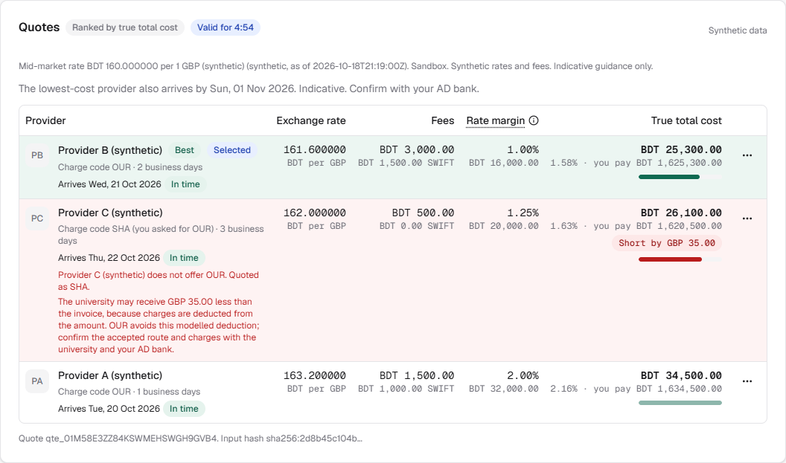
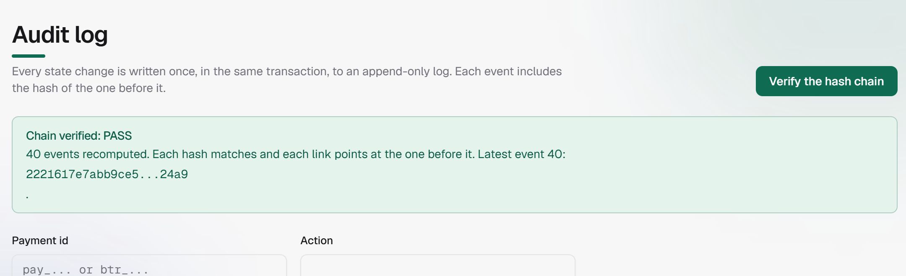

# StudyRoute: technical report

International Track, Topic C: Cross-border and Student Finance Assistant. Team: TeamEkxin.
Code and evidence: https://github.com/NoobCrow/StudyRoute (public; run it with docker compose up --build, then open http://localhost:8080).

> StudyRoute is a sandbox. No real money moves and all data is synthetic. Guidance is indicative:
> confirm with your Authorised Dealer (AD) bank.

---

## Summary

We built StudyRoute because paying a university abroad from Bangladesh is harder than it should be. A parent
types one sentence, and StudyRoute turns it into a ranked, deadline-aware payment plan that only that parent
can approve. In this report we explain how we built it, how we tested it, and where our evidence stops.

**Table 1. Where we stand, by area**

| Area | Where we stand |
| --- | --- |
| Architecture | A pure engine calculates every number. A domain layer enforces a state machine, and approving a payment needs the right role, token scope and ownership, a fresh MFA proof and the hash of the summary the parent actually saw. The models sit behind deterministic checks, and each one can be switched off. |
| Core algorithms | Exact integer-money cost ranking, a deadline planner that respects two calendars, a send-plan optimiser and a currency stress test. Tests assert each of them. |
| Learned components | Four small models: a reader, a dialogue policy, an explainer and a review router. We measured each against a baseline we ran ourselves, none of them can move money, and we report their modest results openly (sections 2.7 to 2.12). Our contribution is the safety envelope around them, not the models. |
| Security | Human-only, MFA-bound approval; idempotency; signed webhooks; a hash-chained audit log; and 146 attacks we ran against our own app. All of it is self-assessed: nobody outside the team has tested it yet. |
| Readiness | A controlled sandbox demonstration on synthetic data. It is not ready for real money. |

> **Our own assessment.** Everything in this report is our description of our own work and the evidence we
> recorded. It is not an audit, a penetration test or a banking approval, and we do not claim the system has
> no vulnerabilities. Sections 5 and 6 set out what we checked and what we did not.

**The problem.** A parent in Bangladesh paying tuition abroad usually compares banks by the fee they are
shown, but the bigger cost is hidden in the exchange rate. In our worked example (GBP 10,000, synthetic rates),
63% of the best provider's cost is margin: BDT 16,000 of BDT 25,300. Banks along the way can take fees from
the amount and leave the university short-paid, the due date has to fit two countries' calendars, and nobody
tells the family clearly which documents the bank will want. The need is real and growing. Bangladesh Bank
data, reported by The Observer on 24 July 2026 [8], show USD 881.7 million sent through banks for overseas
education in 2025-26, a record and 32% more than the year before.

**What we built.** A parent types something like "I need to pay GBP 10,000 tuition by 28 October". StudyRoute
answers with a quote in which every provider is ranked by its true total cost, a deadline plan across both
countries' working days, a document checklist and a draft payment. The parent approves with a fresh MFA proof
tied to the exact summary they saw. A simulated provider then settles the payment, and every step lands in a
hash-chained audit log. Around that core we added a budget and arrival guide for the student, a simulated bank
network, an escrow on a simulated chain, and a bank review desk that routes unusual payments to a person.

**What we think is ours.** None of the building blocks is new. Decimal arithmetic, JWT, Argon2, HMAC, hash
chains, ONNX, Double DQN and distillation are all well established. What we contribute is the way we put them
together and how carefully we checked the result.

Our thesis is simple: AI should be allowed to take part in a financial decision only if it cannot be the
financial authority. We built the envelope that makes that true, and then we measured four small models inside it.

1. **The envelope.** A language model can help without being able to hurt. Every number comes from a pure
   engine. Every learned component has a deterministic check or a fallback around it. Only a person with a
   fresh MFA proof can approve a payment, and a permission table in code, not a prompt, enforces that.
2. **Four small models, each with one job.** A reader for untidy requests, a dialogue policy, an explainer
   that rewords the engine's answers, and a router that decides which payments a bank reviewer should look at
   first. We measured each against a baseline we actually ran, and we publish the limits.
3. **Evidence you can re-run.** 1,705 backend tests (1,704 pass on Windows, where one symlink test is
   skipped), including a 25-prompt assistant suite; 463 web tests and 24 browser tests; all 24 blueprint
   scenarios pass. On top of that come a 146-attack black-box probe, a run in Docker, and a record of what
   those runs found, including a defect.

**Evidence at a glance** (sources in section 5 and in the submission/evidence folder):

**Table 2. Evidence at a glance**

| What we measured | Result | How to read it |
|-------------------|--------|----------|
| Cost ranking, worked example | B 1.58%, C 1.63% (university GBP 35 short), A 2.16% | Exact; asserted in test_engine_quote.py |
| Backend tests | 1,705 (1,704 pass, 1 skipped on Windows); 24 of 24 blueprint scenarios pass | The same count on a fresh clone |
| Assistant prompt suite, 25 prompts | 25 of 25 give the expected intent, tool and safety outcome (6 attacks blocked, nothing proposed) | Our own prompts (test_prompt_suite.py) |
| Black-box attack probe | 146 of 146 defended; real-browser audit 48 of 48 | We wrote these tools ourselves; not independent |
| Reader against rules, 113 frozen hand-written messages | Intent 88.5% against 61.1%; plan read exactly 100% against 57.6%; attacks blocked 92.9% against 28.6% | Small sample, about plus or minus 7 points |
| Dialogue policy against plan-at-once, simulated parents | Wrong plans 0.8% against 2.8%; 1.17 questions against 0.44 | The simulator is our own assumption |
| Explainer, 700 held-out questions | 80.9% of answers pass every check; 0.4% invented a figure; what a person reads has 100% figure precision | It mostly rewords; see 2.10 |
| Review router, on a later period it never saw | Puts 63.2% of the flagged payments in its top 1% (random order: 1.2%); average precision 0.437, about 240 times random | It orders well; as a yes/no flag it is modest (section 2.11) |

**Limits.** The providers, fees, rates, KYC, banks and settlement are all simulated, and the rates and fees
are invented. No real parent or bank has used StudyRoute, and nobody outside our team has tested its security.
We trained the review router on public synthetic data, and as a yes/no flag it is modest. The chain is an
in-memory simulation. Most Bangladesh Bank figures are still unverified placeholders. Section 6 has the full list.

---

## 1. System architecture

### 1.1 The problem and the design principle

We started from five problems families actually face, and each one maps to a part of the system:

**Table 3. Five problems families face and where we handle them**

| Problem | Where we handle it |
|------|---------------------|
| The posted fee hides the exchange-rate margin | True-total-cost ranking (2.1) |
| Fees deducted on the way leave the university short | Shortfall warning and charge-code advice (2.1) |
| The due date spans two calendars | Deadline planner and deadline fit (2.3, 2.4) |
| Paperwork and unclear documents | Checklist per corridor, KYC gate, compliance report (1.4, 4.3) |
| A large transfer approved with little to check it against | Approval summary hash, MFA, bank review desk (1.4, 2.12) |

Our design principle fits in one line: **the engine calculates, the AI explains, the human approves, and
every step is logged.** Each part of that line is a real mechanism with a test behind it:

**What is real and what is not.** Real: the problem itself, the Bangladesh Bank volume figure (USD 881.7m,
via The Observer, 24 July 2026), and four study-abroad rules we read in Bangladesh Bank circular FEPD-1 No. 40
(no lawyer or AD bank has reviewed our reading). Synthetic: every rate, fee, margin, provider, KYC result,
sanction, bank, settlement and student-city cost. Simulated: the chain (in-memory py-evm), the escrow and the
bank network. The USD 8.8m saving is our own arithmetic, not a forecast.

**Table 4. What we promise, how it works and where it is tested**

| What we promise | How it works | Where it is tested |
|-----------|-----------|------|
| The engine calculates | A pure engine with no database, clock or network access; money as integers; a number guard rejects any figure in a reply that the engine did not produce | test_engine_quote.py, test_ai_number_guard.py |
| The AI explains | Models only reword engine drafts or propose a draft; every rewrite must pass code checks, or the engine's own text is shown | test_explainer_integration.py |
| The human approves | A permission table in code; approval needs a fresh MFA proof bound to the payment and to the summary hash; the AI account gets AI_CANNOT_APPROVE | test_rbac.py, test_api_payment_guards.py |
| Every step is logged | One audit event per state change, in the same transaction; a SHA-256 hash chain; triggers block edits | test_audit.py and the tamper demonstration |

### 1.2 Components


**Figure 1. System architecture**

```
 Browser (Next.js static export, React + TypeScript)
        |  same origin, strict CSP
        v
     nginx  --- serves the built UI, proxies /api, sets X-Forwarded-For
        |
        v
 FastAPI  (security middleware: request id, size limit, headers, X-Sandbox)
   |   auth (JWT ES256) - RBAC - rate limit - schema validation - Idempotency-Key - RFC 7807 errors
   |
   +--> Engine    pure functions: money, FX margin, fees, ranking, planner, runway, MT103 preview
   +--> Domain    state machine, KYC gate, limits, sanctions check, recipients, documents, rules
   +--> AI layer  policy check, facts, masking, models (optional), number guard, tool guard
   +--> Audit     append-only hash chain, verify
   +--> Providers mock adapters A, B, C  -->  simulator  -->  HMAC-signed webhooks back to the API
   +--> Bank network  invented banks, clearing houses and a correspondent  -->  double-entry ledger
   +--> Sandbox chain Solidity contracts on an in-memory EVM: escrow, tokenised deposit, audit anchor
   |
   v
 SQLite (Postgres optional), foreign keys on, CHECK constraints, audit triggers
```

**Table 5. Components by layer**

| Layer | Folder | What it does | I/O |
|-------|--------|----------------|-----|
| Engine | backend/app/engine/ | Every number: costs, ranking, deadline, runway, student budget, bank-transfer journals | None (pure) |
| Domain | backend/app/domain/ | State machine, guards, RBAC, KYC, limits, config, ledger, bank network, bank review | Database, through a session passed in |
| API | backend/app/api/ | Routes, authentication, idempotency, rate limits, errors | HTTP |
| Audit | backend/app/audit/ | Hash chain and verification | Database |
| Chain | backend/app/chain/, contracts/ | Compiled contracts, ABI codec, in-memory EVM (py-evm) | None (memory) |
| Providers | backend/app/providers/ | Mock providers, simulator, webhook signing | HTTP (webhooks) |
| AI | backend/app/ai/ | Orchestrator, masking, guards, tools, the four models | Optional call to an external model |
| Web | web/ | Dashboard, compare, payments, recipients, documents, student guide, audit, rules, bank network, escrow, bank review, sandbox, assistant | HTTP |

### 1.3 Design decisions and what they cost us

**Table 6. Design decisions and what they cost**

| Decision | Why we made it | What it costs |
|----------|-----|---------------|
| Money as integer minor units plus a currency; rates as Decimal; each part rounded once, half-up, at the end | Totals are exact and reproducible, and a test checks that the total equals the sum of its parts | More conversion code; the engine builds the display strings |
| A pure engine | Every number has one origin and can be tested without a database | The domain layer has to pass the data in |
| SQLite, with triggers for append-only tables | Anyone can start it with one command (docker compose up) | No database roles: whoever owns the file can drop the triggers (risks R7, R8) |
| Small local models (ONNX or NumPy) by default, instead of a hosted model | Works offline with no key; no data leaves the machine; we check each model file's hash | Modest quality, which we measure and report in sections 2.8 to 2.11 |
| Every model is optional, with a deterministic fallback | A failing model can never block a payment; NLU_MODE, DIALOGUE_MODE, EXPLAINER_MODE and RISK_MODE can each be switched off | Two paths to test |
| Every payment needs a person's MFA authorisation, whatever its risk score | The score helps decide who looks; it is never an authority | No automatic approval path, on purpose |
| Simulated providers, banks, KYC and chain | No real money and no credentials, so a judge can run everything | The figures illustrate the method; they are not calibrated against real quotes |

### 1.4 Payment lifecycle


**Figure 2. Payment lifecycle**

```
DRAFT -> QUOTED -> PENDING_APPROVAL -> APPROVED -> SUBMITTED -> SETTLED
            |            |                |             |-----> FAILED
            |            |-> REJECTED     |-> CANCELLED
            +--- quote expires: QUOTED or PENDING_APPROVAL returns to DRAFT
```

We wrote the state machine as a transition table. Each row names the event, the states it may start from, the
state it leads to, who may trigger it (parent, AI, admin, system or provider) and the guards that must hold.
An illegal move returns 409 INVALID_STATE. Every transition writes one audit event in the same database
transaction, and an optimistic-lock version column stops two simultaneous approvals from both succeeding.

Before a payment can be approved, all of these must hold: the quote is still valid, KYC is verified, the
recipient is allowlisted, the mock sanctions check is clear, the sandbox per-transaction and daily caps hold,
any bank review that was opened has been cleared, a fresh MFA proof is presented, and the hash of the approval
summary the parent saw still matches.

### 1.5 Request path

1. The parent compares providers, creates a draft and requests approval. The assistant can explain any number
   and can *propose* a draft, but a person clicks every step.
2. Requesting approval freezes a summary (recipient, amount, rate, charge code, total cost, latest send date,
   quote expiry) and stores its SHA-256. The risk router rates the payment and may open a bank review.
3. The parent approves with an MFA proof and the summary hash they confirmed. If anything has changed since,
   the hashes differ and the approval is refused.
4. A background worker submits the approved payment after a short cancellation window, assigns a UETR and
   hands it to the mock provider. The simulator later sends an HMAC-signed webhook; the API verifies it and
   records SETTLED or FAILED.

### 1.6 Data model

The main tables are users, recipients (account numbers stored encrypted with AES-256-GCM, with only the last
four digits shown), quotes (inputs, results, mid-rate source and time, input hash), payments (state, summary
hash, version for optimistic locking), payment_transitions, audit_events, audit_head, idempotency_keys (unique
per user and key), webhook_events (unique event id), config_rules (value, source URL, last checked, verified),
kyc_records, documents, mfa_proofs, refresh_tokens and provider_ledger. The bank network adds bank_accounts,
bank_transfers, bank_transfer_events, ledger_journals and ledger_entries. A CHECK constraint limits the payment
state, and triggers block UPDATE and DELETE on audit_events, ledger_journals and ledger_entries.

### 1.7 The product on the live site

We also run the sandbox publicly at https://studyroute.bot-keep.xyz, with synthetic data only. We took the two
screenshots below there on 19 October 2026.

*The comparison a parent sees for GBP 10,000 of UK tuition. The ranking is the one our test T01 asserts: B at
1.58%, C at 1.63% with a GBP 35 shortfall warning, and A at 2.16%.*



**Figure 3. The live comparison for GBP 10,000 of UK tuition**

*The reviewer's audit log. Verify the hash chain recomputes every event and reports PASS.*



**Figure 4. The live audit log after hash-chain verification**

---

## 2. Core algorithms and trained components

### 2.1 True total cost

All rates are in BDT per one unit of foreign currency. A provider selling foreign currency quotes above the
mid-market rate, and the gap is the hidden margin. For one provider, with target amount T (in foreign
currency), mid rate m and margin g percent:

```
provider_rate      = m * (1 + g/100)                         (six decimals)
fx_cost_bdt        = (provider_rate - m) * T
if charge_code == OUR:   sender_extra_bdt = (intermediary_fee + receiving_fee) * m ; shortfall = 0
else (SHA or BEN):       sender_extra_bdt = 0 ; shortfall_foreign = intermediary_fee + receiving_fee
                         (BEN also deducts the provider's fixed fee from the beneficiary)
shortfall_bdt      = shortfall_foreign * m
total_cost_bdt     = fx_cost + fixed_fee + swift_fee + sender_extra + shortfall_bdt
cost_pct           = total_cost_bdt / (T * m) * 100
parent_pays_bdt    = T * provider_rate + fixed_fee + swift_fee + sender_extra
```

We rank by cost_pct, then by what the parent pays, then by provider id, so the order is always the same. We
rank by the share of the amount at the mid rate because the parent's real question is "how much of my money
disappears?", and comparing flat fees can never show the margin. If a provider cannot offer the requested
charge code, we quote it with its default code and show both codes and a warning.

**Worked example** (synthetic; GBP 10,000; mid rate 160.00):

**Table 7. Worked example: true total cost (synthetic)**

| Provider | Rate | Fixed + SWIFT | Charge | Shortfall | Total cost | Cost % | Parent pays |
|----------|------|---------------|--------|-----------|------------|--------|-------------|
| B | 161.60 | 3,000 + 1,500 | OUR (GBP 30 intermediary) | 0 | BDT 25,300 | 1.58% | BDT 1,625,300 |
| C | 162.00 | 500 + 0 | SHA (GBP 25 + 10 deducted) | GBP 35 | BDT 26,100 | 1.63% | BDT 1,620,500 |
| A | 163.20 | 1,500 + 1,000 | OUR (fees bundled) | 0 | BDT 34,500 | 2.16% | BDT 1,634,500 |

B comes first. C comes second, but with a red shortfall warning: the university would receive only GBP 9,965.
Of B's BDT 25,300, the FX margin is BDT 16,000 (63%), the fixed fee 3,000, the SWIFT fee 1,500 and the OUR
fees 4,800. Every figure in this table is asserted in our test for blueprint scenario T01. The providers and
their fees are invented for the sandbox, so the table shows how the engine ranks, not what a real provider
would charge.

Zero, negative and unsupported amounts are rejected with 422 VALIDATION_FAILED.

### 2.2 Quote lifecycle

A quote stores every input, the source and time of the mid rate, and an input hash. It expires after 300
seconds (configurable). Approving with an expired quote returns 409 QUOTE_EXPIRED and sends the payment back
to DRAFT, so the parent simply asks for a fresh quote.

### 2.3 Deadline planner

We count a day as a business day only if it is a working day both in Bangladesh (where Friday and Saturday are
off) and in the host country (with its own weekend and holidays, from configuration).

```
latest_send_date    = due_date stepped back (settlement_days + buffer_days) business days
recommended_send    = latest_send_date stepped back one more business day
earliest_send_today = today if business day and before the bank cut-off, else the next business day
status:  ON_TRACK  if earliest <= recommended
         TIGHT     if earliest <= latest        (using the buffer)
         AT_RISK   if earliest <= latest_without_buffer
         LATE      otherwise
```

Every skipped day comes back with its reason ("BD weekend", "GB holiday: ...") and is shown on screen. A scan
limit stops a misconfigured calendar from looping forever.

### 2.4 Deadline fit

The cheapest provider can also be the slowest, and money that lands after the due date means a late fee.
Using the send date and each provider's settlement time in business days, the engine works out which providers
arrive in time and which of those is cheapest. If the cheapest one would be late, the quote says so and names
the next best.

### 2.5 Smart send plan

Fixed and SWIFT fees are paid on every transfer, while the margin grows with the amount, so how often a family
sends money changes the real cost. For a total T over m months, the engine compares sending monthly, every
three months, every six months and all at once. It splits T into equal transfers (the amounts differ by at
most one minor unit and add up exactly to T), prices each transfer with every provider using the formulas in
2.1, and keeps the cheapest provider. It never picks a provider that would leave the beneficiary short while
another one would not.

A worked case (synthetic; GBP 12,000 over 12 months; charge code OUR): sending monthly costs BDT 68,400 with
Provider A; every three months BDT 48,400; every six months BDT 37,800 with Provider B; and all at once BDT
28,500, a saving of BDT 39,900 against monthly (asserted in test_engine_cadence.py). The engine does not try to
predict exchange rates, so we state the trade-off (money sent early, rate locked early) rather than price it.

### 2.6 Currency-drop stress test, runway and student budget

The stress test re-prices a stored quote with the foreign currency 5, 10, 15 or 20% dearer in taka, for the
same provider and with the same fee engine. Fixed fees in taka stay put. It is a read-only what-if on synthetic
rates, and it says clearly that it is not a forecast. The runway reports how many whole months an amount
covers, rounded down so it never over-promises. The student budget converts a month's costs in 20 student
cities into taka and rounds up, so it never tells a parent a month needs less than it does. The city costs are
invented and marked "Not verified".

The next six subsections cover the assistant pipeline and the four trained models inside it.

### 2.7 The assistant pipeline


**Figure 5. The assistant pipeline**

```
 user message --> 1 policy check --> 2 facts from the engine --> 3 mask personal data
              --> 4 model (optional) --> 5 number guard --> 6 tool guard --> 7 un-mask --> 8 audit
```

1. **Policy check.** Pattern rules flag attempts to override instructions, requests to act (approve, send,
   cancel), attempts to change limits or configuration, false claims of privilege, requests for secrets and
   requests to make up numbers. A flagged message gets a fixed refusal, and the model is never called.
2. **Facts.** The orchestrator builds a numbered list of facts from engine output only.
3. **Masking.** Names become [PERSON_n], account numbers and long runs of digits become partial tokens, and
   passports, e-mails and phone numbers are removed and never put back.
4. **Model.** Optional. By default this is our local trained explainer (2.10); a configured external model can
   take its place. The model sees only the masked facts and must answer with the ids of the facts it used.
5. **Number guard.** Every number in the reply must match a number in the allowed facts. Anything else fails
   the reply, which is retried once and then replaced by the deterministic template answer built from the same
   facts.
6. **Tool guard.** The model may only propose create_draft or request_approval. Approving, submitting,
   cancelling, changing a limit, allowlisting and editing configuration are simply not available to it.
   The read-only tools are get_quotes, explain_cost, get_deadline_plan and get_checklist. In our plan they
   were named get_quotes, check_deadlines, compute_runway, create_proposal and execute_in_sandbox: check_deadlines
   became get_deadline_plan, compute_runway is the engine's runway calculation (read-only, no tool of its own),
   create_proposal became create_draft and request_approval, and execute_in_sandbox is deliberately not an AI
   tool, because only the parent's MFA approval and the provider simulator can move a payment forward.
7. **Audit.** One event records the prompt hash, output hash, model version and guard result.

Questions to the parent, and read-backs of what the assistant understood, are always shown word for word. We
added that rule after our Docker run (section 5) caught the explainer rewording a confirmation question badly.

### 2.8 The reader: intent and marked words

*The problem.* Parents write untidy requests, such as "kindly help me send ten thousand pounds for my son's
tuition, last date end of November". Our rule-based reader understood only 61.1% of intents on our frozen
hand-written messages.

*What we built.* A small fine-tuned model (bge-small-en-v1.5 [5], 33.8 MB as int8 ONNX) that predicts one of
14 intents and marks the exact words that carry an amount, a currency, a date, a period, a charge code, a
purpose or a provider. It only proposes. Plain code then turns the marked words into typed values (integer
minor units, a real date) and refuses anything it cannot read exactly. When the rules and the model read a
field differently, we leave the field empty and the assistant asks. We use the model's intent only when its
confidence is at least 0.8, and a confident ATTACK can only add a block, never remove one. Three intents
(stress test, student costs, arrival guide) are decided by exact rules, because the model never saw those
questions in training. The model has no permissions of its own. On a CPU it takes a median of 18 ms and a
95th percentile of 57 ms per message. If the model file is missing, fails its integrity check or is switched
off (NLU_MODE=off), the assistant runs on the rules alone.

*Bangla and Banglish.* The reply language is chosen for each message: Bengali script, common Banglish words
(Bengali written in Latin letters) or an explicit "reply in Bengali" switch the reply language, and "reply in
English" switches it back. Greetings and the app overview have Bengali versions in every mode. Other answers
are in Bengali or Banglish only when a cloud model is configured, which we have not yet tested against a real
provider; the offline templates answer in English. The trained reader is an English model, so payment requests
are read most reliably in English, and the assistant asks for any value it cannot read.

*How we trained it.* 35,588 messages, mostly generated from templates, plus real bank-customer questions
(Banking77 [2], CC BY 4.0). Six epochs on an RTX 5060 Ti took 238 seconds. The results below come from our
evaluation script (ai_evaluation.json), on data the model never trained on:

**Table 8. The reader against the rules on held-out data**

| Evaluation set | n | Right intent: rules | Right intent: model | Attacks blocked: rules | Attacks blocked: model |
|----------------|--:|--------------------:|--------------------:|-----------------------:|-----------------------:|
| Frozen hand-written holdout (now reproduced) | 113 | 61.1% | **88.5%** | 28.6% | **92.9%** |
| Real bank questions (Banking77 test, mapped) | 680 | 40.1% | **95.1%** | n/a | n/a |
| Held-out template wording | 11,004 | 62.0% | **90.2%** | 52.1% | **85.1%** |

On the hand-written set the model also reads a plan request exactly right 100% of the time, against 57.6% for
the rules; harmless messages blocked by mistake are 2.0% for both. The hand-written set is small (about plus or
minus 7 points) and the other sets are mostly synthetic.

### 2.9 The dialogue policy (reinforcement learning)

*The problem.* When a message starts a payment plan, should the assistant plan straight away, ask for a missing
amount, date or period, or read the values back and wait for a yes? Planning at once is fast but sometimes
wrong; asking every time is safe but tiring.

*What we built.* A 30 → 64 → 64 → 5 network trained with Double DQN [3] against a simulated parent whose
sentences were run through the real reader, so the noise it learns from is the system's own. The state
describes how each value was read, how sure the model was, whether a second amount was mentioned, and how many
turns have passed. Rewards: +1 for a correct plan, +0.5 for a correct deadline or period, -2 for a wrong
amount, -1 for a wrong deadline or period, -0.05 per question, and -0.5 if the parent gives up. The network
never decides what is allowed: plain code works out the legal actions and the network only ranks them. None of
its five actions moves money.

*Results* (6,000 simulated conversations per policy; ai_rl_evaluation.json):

**Table 9. Dialogue policy results in simulation**

| Policy | Mean return | Questions asked | Wrong plans |
|--------|------------:|----------------:|------------:|
| Plan as soon as the amount is known (before) | 1.164 | 0.44 | 2.8% |
| Random legal action | 1.236 | 1.07 | 2.2% |
| **Trained policy** | **1.358** | **1.17** | **0.8%** |
| Best hand-written rule (ask everything, confirm every time) | 1.343 | 1.97 | 0% |

The trained policy matches the best hand-written rule's return with about 40% fewer questions, at the price of
0.8% wrong plans in simulation. Under a harsher penalty for a wrong amount it did not quite match "always
confirm", so the API wraps it in a mandatory read-back that the policy cannot override. With DIALOGUE_MODE=off, the assistant plans as soon as
the amount is known.

### 2.10 The explainer: rewording the engine's answer

*The problem.* Template answers read stiffly, and a free language model can invent a figure. We wanted a model
that rewords the engine's draft and is structurally unable to change a number.

*What we built: verified distillation.* A larger open model (Qwen2.5-1.5B-Instruct [6]) proposed rewrites for
6,000 training drafts. A code check kept only the faithful ones: no new figure, most figures kept, the
disclaimer and any refusal kept, no action or legal claim, and "(synthetic)" kept. More than half of the raw
teacher output failed (7,785 of 18,000 proposals passed, 43.3%), which is exactly why our student model never
learns from a raw proposal. The student (flan-t5-small [7], 77M parameters) was fine-tuned on the verified
rewrites in 12 minutes. We pruned its vocabulary from 32,000 to 5,124 pieces and exported it to int8 ONNX
(53 MB). At run time every rewrite is checked again; if it fails, we throw it away and show the engine's own text.
Drafts over 120 words skip the model, because it cannot finish long structured answers.

*Results on 700 held-out questions* (ai_explainer_evaluation.json):

**Table 10. Explainer results on held-out questions**

| | Trained explainer | Same model, untrained |
|---|---:|---:|
| Answers that pass every check and are shown | **80.9%** | 20.1% |
| Answers that invented a figure | **0.4%** (3 of 700) | 1.4% |
| Answers identical to the engine's draft | 48.6% | 0.4% |
| Figure precision, raw output / what a person reads | 99.8% / **100%** | 96.1% (raw) |
| Figure recall, raw output / what a person reads | 97.5% / 98.8% | 21.3% (raw) |

### 2.11 The review router: which payments a person looks at first

*The problem.* A bank reviewer has limited time. Which payments deserve a look first, and why?

*The data.* IBM's public synthetic anti-money-laundering transactions [1] (HI-Small: 5,078,345 transactions,
5,177 labelled by the generator; CDLA-Sharing-1.0). We split it by time: the first 60% trains, the next 20%
tunes, and the last 20% (1,015,564 transactions, 1,797 flagged) is the test. Every count of "earlier payments"
uses only earlier rows.

*What we built.* A small network on eight inputs grouped into four factors: **amount** (a percentile within the
currency), **frequency** (payments by this household in the last day, the last week and ever), **timeline**
(time since the last one) and **person** (whether this household has paid this receiver before). The risk bands
come from cut-offs set on the tuning period only: HIGH is the top 0.1% of scores and MEDIUM the next 0.4%. For
each payment, the model hides each group of inputs in turn to show which factors drove the score. A MEDIUM or
HIGH rating opens a bank review; LOW takes the fast lane. The model never clears, declines or approves
anything, and every payment still needs the parent's MFA authorisation.

*Inputs we removed.* Our first version also used the payment channel, the currencies and
the hour, and it scored higher. When we counted labels per channel, we found that in this data no wire and no
cross-currency transfer is ever labelled as laundering. A model with those inputs would learn that a
cross-currency wire, which is exactly what every StudyRoute payment is, is the safest thing there is. That is a
habit of the data generator, not a fact about money, so we removed those inputs. Dropping the channel inputs
cost nothing in average precision (0.449 without, 0.412 with, first pass).

*Results on the test period* (1,015,564 transactions, 1,797 of them flagged; ai_risk_training.json and
ai_risk_operating_points.json).

**Ordering.** How many of the flagged payments are among the 1% of payments with the highest score?

**Table 11. Review router: ordering**

| Ordering | Flagged payments found in the top 1% | Average precision |
|----------|-------------------------------------:|------------------:|
| Random order | 1.2% | 0.0018 |
| Shipped model | **63.2%** | **0.437** (about 240 times random) |

**As a yes/no flag.** The desk sends a payment to a person when its band is medium or high. Accuracy here is
the share of all payments handled correctly: a flagged one sent to a person, or an unflagged one left alone.

**Table 12. Review router: routing**

| Routing | Sent to a person | Accuracy | Precision | Recall |
|---------|-----------------:|---------:|----------:|-------:|
| Medium or high (the desk's rule) | 3,474 of 1,015,564 (0.34%) | 99.68% | 29.2% | 56.5% |
| High only | 1,548 (0.15%) | 99.83% | 52.6% | 45.4% |
| Best F1, threshold from the tuning period | 962 | 99.86% | 67.5% | 36.1% |
| Never flag anything | 0 | 99.82% | – | – |

Because 99.82% of the payments are not flagged, a router that never sends anything to a person is already
99.82% accurate. Accuracy alone therefore cannot tell our router from no router at all; the ordering table can.
Precision and recall cannot both exceed 90% on this data at any threshold, and we did not change the
evaluation set or the threshold to get a bigger number.

*Model comparison* (AI_RISK_MODELS.md in the docs folder; 24 configurations: ten learned models and four rule or
random baselines, on the eight shipped inputs or thirteen):

**Table 13. Review router: model comparison**

| Configuration | Tuning AP | Test AP |
|---------------|----------:|--------:|
| XGBoost, 13 inputs | **0.488** | 0.448 |
| Random forest, 13 inputs | 0.475 | 0.540 |
| Neural network 128-64, 13 inputs | 0.438 | **0.545** |
| **Neural network 128-64, 8 inputs (shipped)** | 0.340 | 0.437 |
| Logistic regression, 8 inputs | 0.285 | 0.088 |
| Rule: a new receiver | 0.073 | 0.114 |
| Random order | 0.001 | 0.002 |

By our own rule (choose on the tuning period only), XGBoost on thirteen inputs comes first, yet on the test
period it is no better than the network we shipped, within noise (0.448 against 0.437); neighbouring models
differ by about 0.02 average precision, which is within noise with 1,797 flagged transactions. The
thirteen-input variants score higher than our shipped network on both periods. Their five extra inputs all come
from the household's payment history: payments to the same receiver in the last 24 hours, new receivers in
the last 24 hours and in the last 7 days, hours since the same receiver was last paid, and this amount compared
with the previous one. None of them is a channel, currency or time-of-day input, so adopting them does not bring
back the generator artifacts we removed. We did not ship one because those inputs must be computed from payment
history at run time, and the review desk would have needed re-testing before the freeze. Adopting them is first on our list of improvements.

### 2.12 The bank review desk

When a parent requests approval, a MEDIUM or HIGH rating (or a match on the sandbox name list) opens a bank
review with a target time, the signals and the model's reading, and writes one audit event. The approval guard
then refuses with BANK_REVIEW_PENDING until a reviewer answers. The reviewer, an admin user, answers CLEAR,
ASK_INFO or DECLINE with a single-use MFA proof under the scope review_payment. A decline calls the existing
rejection, so the state machine itself does not change. The parent's short reply is stored sealed with the
field cipher. A clock (on time, due soon, overdue) and a reminder with a cool-down make slow reviews visible.
Plain rules (a large amount, several payments that add up to one, a new receiver, no fee demand note) give the
reviewer context, and they decide on their own only when the model is not loaded. BANK_REVIEW.md describes the
desk in full.

---

## 3. Security design

The full threat and control matrix, with the test that proves each row, is in SECURITY.md.
The permission tiers and our 55 known risks are in SECURITY_SELF_ASSESSMENT.md.

### 3.1 Identity and sessions

Passwords are hashed with Argon2id at the OWASP minimum parameters. Access tokens are ES256 JWTs that last 15
minutes. The programmatic API issues rotating refresh tokens with reuse detection. The browser takes a separate
path: an opaque HttpOnly, SameSite=Strict cookie session, stored on the server as a hash and bound to the access
token. Browser sign-in endpoints insist on an exact trusted Origin and a custom header, so a cookie on its own
never carries API authority. The access token lives only in page memory. Repeated failures lock the account,
and unknown users get exactly the same answer, so nobody can discover e-mail addresses by trying to lock them.

### 3.2 Authorisation

To do anything, a user needs the role's permission, a matching scope in the token, and ownership of the object;
asking for another household's object returns 404. The AI service account has no approve, cancel, reject,
allowlist, limit or configuration permission, and our tests check both the permission table and the AI
account's refusals (test_rbac.py and test_api_ai_rbac.py).

### 3.3 Payment safeguards


**Figure 6. Safe approval sequence**

*MFA step-up.* A fresh proof is needed to approve a payment, allowlist a recipient, confirm an escrow, make a
bank transfer and answer a bank review. Each proof is valid for 5 minutes, works once, and is bound to the user,
the scope and the object id, so a proof for one payment can never approve another. TOTP (RFC 6238 [4]) works in
every mode; sandbox mode also accepts a documented fixed code so that judges do not need an authenticator app.
That fixed code is a sandbox shortcut, not production-strength verification, and it has to go before any real use.

*Idempotency.* Every payment write needs an Idempotency-Key. We store the key, a hash of the method, path and
body, and the response in the same transaction as the change, for 24 hours. Repeating the same key and body
replays the stored response with no second effect; the same key with a different body returns 422. A unique
constraint keeps two simultaneous requests safe.

*Webhooks.*
```
signature = HMAC_SHA256(secret, timestamp + "." + raw_body)      header: t=<ts>,v1=<hex>
```
The receiver reads the raw body, rejects a timestamp more than 300 seconds old, recomputes the HMAC for both the
current and the previous secret, compares in constant time, de-duplicates by event id, and only then parses the
JSON. Every rejection writes an audit event and changes nothing else.

### 3.4 The audit log: what it guarantees and where it stops


**Figure 7. Audit hash chain**

```
GENESIS             = "0" * 64
canonical(e)        = JSON of e without this_event_hash, keys sorted, no whitespace, UTF-8
this_event_hash(e)  = SHA256( prev_event_hash + canonical(e) )
verify:  prev = GENESIS
         for e in events ordered by seq:
             fail at e.seq if e.prev_event_hash != prev
             fail at e.seq if SHA256(prev + canonical(e)) != e.this_event_hash
             prev = e.this_event_hash
```

Every new event locks the head row before it is appended, so writers arriving at the same time still produce a
single linear chain, and database triggers refuse any UPDATE or DELETE on the log. We tested this ourselves: in
a recorded run we changed one amount in event 74 behind the application's back, and verification failed at
exactly that event; when we put the amount back, it passed again. The evidence is the tamper_demo.json file in
submission/evidence.

The chain is tamper-evident rather than tamper-proof. The audit events and the simulated
chain's log live in the same SQLite file, so someone who owns that file could rewrite and re-hash both
consistently, and one of our regression tests shows exactly that. What catches it is a checkpoint stored outside
the database (the audit_checkpoint.py script). The simulated chain gives us a second anchor and lets us explore
on-chain ideas, but it adds no independent security: it has no peers, no consensus and no keys.

### 3.5 Data and AI safety controls

Account numbers and document text are stored with AES-256-GCM, and only the last four digits of an account are
ever shown. Log output passes through a redaction filter. Personal data is masked before any text reaches a
model. The number guard, tool guard and policy check from section 2.7 apply to every model, local or external.
We check each model file's SHA-256 before it loads; that proves the file matches our manifest, not who published it.

### 3.6 Web and abuse controls

A strict content-security policy with no inline style and no inline script, except the exported pages' own
bootstrap scripts, which are allowed by their SHA-256 hash; nosniff; no-referrer; frame-ancestors none; HSTS;
and exact-origin CORS without credentials. On top of that come per-IP and per-user rate limits, a request size
limit, and schema validation that rejects unknown fields.

### 3.7 Compliance posture

Every rule and limit lives in configuration with a source URL, a last-checked date and a verified flag.
Anything not yet checked shows a yellow "Not verified" badge and the sentence "Indicative. Confirm with your AD
bank." The application never says that something is legal or within a limit. On 18 October 2026 we read section
10 of Bangladesh Bank's circular FEPD-1 No. 40 (30 September 2026) and marked four study-abroad rules as
verified: one AD bank branch for the whole course, one academic year at a time, release according to the
institution's estimate, and international cards for education payments. The USD 2,000 a month living-cost figure
we found in a secondary source is not in that text, so it stays unverified. This is our own reading, and no
lawyer or AD bank has reviewed it.

### 3.8 Residual risks and release gates

These are the ten residual risks that matter most, taken from our Security Self-Assessment, which covers the
same commit and cross-references the full 55-item register in SECURITY_SELF_ASSESSMENT.md:

**Table 14. Ten residual risks and their priority**

| ID | Residual risk | Priority |
|----|---------------|----------|
| SR-01 | Shared demo accounts, public hints and a fixed MFA code: deliberate sandbox shortcuts | High |
| SR-02 | Credentials exposed in earlier workspace material; revoking them is the owner's job | High |
| SR-03 | A privileged database owner can rewrite the audit log and the simulated-chain log consistently | High |
| SR-04 | Invented rails and quotes, and most regulatory thresholds, are not production rules | High |
| SR-05 | A public deployment (TLS, proxy trust, restore) has not been validated | High |
| SR-06 | Heuristic filters and statistical models miss some attacks | Medium |
| SR-07 | Model and dependency substitution: a hash shows consistency, not the publisher's identity | Medium |
| SR-08 | Privacy, retention and external AI providers | Medium |
| SR-09 | Rate limits are per process; no identity lifecycle at scale | Medium |
| SR-10 | The demo reviewer sees every household; there are no real mandates or dual control | Medium |

Eight gates stand between this sandbox and any use with real money or real people: secret custody, real
identity and access, HTTPS and ingress, persistence and restore, independently held integrity checkpoints,
supply-chain checks, licensed real-world integration, and independent assurance. None of them is in place yet.

---

## 4. The simulated financial layer

### 4.1 The bank network


**Figure 8. International transfer through the bank network**

The engine turns a transfer request into a plan: a hold journal and an ordered list of steps, each with the
institution that acts, the simulated message and a balanced journal. For every currency, debits must equal
credits, or building the journal fails. National transfers run over a same-bank, instant, next-batch or
high-value rail. International transfers start from a Bangladesh bank in BDT and are built from the fee engine's
result, so the customer's debit equals what the parent pays and the beneficiary's credit equals what the
beneficiary receives. The ledger applies journals, refuses any that would overdraw an account, and unwinds a
failed transfer by posting the exact opposite of every journal, newest first. Three checks hold at every moment:
the trial balance, the mirror accounts (each nostro equals its vostro) and the entry sums. All of the
configuration is invented. BANK_NETWORK.md describes the network in full.

### 4.2 Smart escrow and the audit anchor

We wrote three Solidity contracts, compiled them once (the compiled artifacts are committed) and run them on
py-evm, a Python implementation of the EVM. One transaction is one block, a revert changes nothing, and wallets
are addresses derived from labels, so there is no private key anywhere. The history is kept in an append-only,
hash-chained log and replayed to rebuild the chain. A parent locks an escrow with a fresh MFA proof for that
escrow (three transactions, one audit event); a worker pays each tranche on its date; paying early or cancelling
needs MFA again; and the reviewer can only freeze or unfreeze. The AuditAnchor contract stores audit head hashes,
and the chain check reports MISMATCH when the database no longer agrees with it. It is a simulation, not a
network. SMART_ESCROW.md covers the contracts and their limits.

### 4.3 The compliance report

For each payment the report gathers the originator and beneficiary, ten controls with a result and the evidence
for each, the approval proof, the state timeline, the payment's part of the audit log, and the verification of
the whole chain. It ends with the SHA-256 of its canonical JSON. The web screen recomputes that hash in the
browser with the same sorted-key compact JSON as the backend, and a test checks the two agree byte for byte,
including Bengali text.

---

## 5. Verification and evidence

**Table 15. Verification and evidence by layer**

| Layer | What we did | Result | Where to find it |
|-------|---------------|--------|-------|
| Automated tests | One or more tests for each of 24 blueprint scenarios; a test fails if any scenario is missing | 1,705 backend tests (1,704 pass, 1 skipped on Windows); 24 of 24 scenarios pass; 463 web tests (439 in an earlier pre-merge log) and 24 browser tests | TEST_CASES.md (docs folder) |
| Assistant prompts | 25 prompts with the intent, tool proposal and safety outcome each must produce | 25 of 25 pass | test_prompt_suite.py |
| Demo flow | A fourteen-step run against a live API | 66 checks OK, none failed | sandbox_operation_log.txt |
| Black-box attacks | Forged tokens, cross-household access, injection, hostile input, webhooks, the bank review desk | 146 of 146 defended | attack_probe.txt |
| Other probes | Brute force, data-leak scan, man in the middle, hostile prompts, real Chrome | 8/8, all clear (50 checks), 14/14, 42/42, 48/48 | the security_2026-10-18 folder |
| Docker | Ubuntu 24.04 VM: smoke, demo, bank review demo, browser audit, hardened overlay | All passed after one fix (below) | the docker_2026-10-18 folder |
| Continuous integration | Six jobs: docker, contracts, web, secret-scan, backend, dependency-audit | All succeeded on the final commit | GitHub Actions |

*A defect we found.* Our first Docker run failed three demo checks, and the same step had failed four in CI. The
trained explainer is switched on by default in a container, and it had never run in one before. It reworded the
assistant's questions and read-backs badly, and our demo checks wrongly assumed a rewrite is always accepted. We
fixed both: questions and read-backs are now shown word for word, and the checks look at the engine's figures
instead of exact wording. We kept the failing run as evidence.

The Docker run used the archive of an earlier commit with the two fixed files copied in. A separately prepared
execution evidence report repeated the backend run on Linux on an earlier archive (1,672 passed; the explainer's
test questions were not in the repository yet) and recomputes the audit chain outside the application. Section 6 lists what this evidence does not cover.

To reproduce our results: run pytest -q in the backend folder; start the API and run the demo_flow script; and
run ml/evaluate.py for the reader. The retraining commands are in AI_AGENT.md, AI_RL.md, AI_EXPLAINER.md and
AI_RISK.md in the docs folder.

---

## 6. Limitations and next steps

1. **Everything financial is simulated.** The providers, fees, margins, KYC, sanctions screening, banks and
   settlement are invented. Our first step is to compare against real dated quotes for one corridor and publish
   the difference.
2. **No real users and no partner yet.** We have not timed the one-sentence flow against a spreadsheet with real
   parents. A pilot with one bank branch and a few dozen families would tell us whether it really helps.
3. **Small models, trained on synthetic data.** This was a deliberate choice: a small model with a fallback can
   never block a payment. The price is modest quality, which we publish rather than hide. The reader's blind set
   is small, the policy learned from a simulator we built ourselves, the explainer mostly paraphrases, and as a
   yes/no flag the router is modest. We should adopt and re-test the thirteen-input variants.
4. **Our security assurance is self-made.** An independent penetration test is the biggest missing piece. Any
   real deployment needs an externally held audit checkpoint. Rate limits work per process. The fixed sandbox
   MFA code must go.
5. **Rules.** Four study-abroad rules are anchored to Bangladesh Bank's circular; the rest are still
   placeholders. Holidays that depend on the moon are not yet in the calendar.
6. **Not built yet.** Credit building, which Topic C mentions, is not built. The escrow and chain remain a
   simulation; a real version would need a permissioned chain and a bank-issued token.

---

## 7. Provenance, licences and AI assistance

We used AI coding assistants for large parts of the code, tests and documents, working under our direction;
the repair release is recorded in PROVENANCE.md. Within the team, Farhan Labib (lead) owned the product, the
engine, the AI components and the documents; Md Redwan Hossen the release hardening, the institution-route checks
and the deployment; Kalvin Chakma the interface design; and Alim Bin Yeasin the demo recording.

**Table 16. Components, licences and how we use them**

| Component | Licence | How we use it |
|-----------|---------|-----|
| BAAI/bge-small-en-v1.5 | MIT | Base of the reader (shipped as int8 ONNX) |
| Banking77 (PolyAI) | CC BY 4.0 | Real customer questions for training and testing the reader |
| google/flan-t5-small | Apache-2.0 | Base of the explainer (shipped as int8 ONNX) |
| Qwen2.5-1.5B-Instruct | Apache-2.0 | Teacher for the explainer; used in development only, not shipped |
| IBM AML transactions, HI-Small | CDLA-Sharing-1.0 | Trained the review router; development only, the data is not in the repository |
| py-evm, onnxruntime | MIT | Run-time dependencies |

The full inventory is in THIRD_PARTY.md. The market figures in the summary come from The
Observer (24 July 2026, citing Bangladesh Bank); our sums and the limits of that business case are in
BUSINESS_CASE.md.

### References

1. Altman, E., Blanuša, J., von Niederhäusern, L., Egressy, B., Luksic, A., Bitar, K. "Realistic Synthetic
   Financial Transactions for Anti-Money Laundering Models." NeurIPS 2023, Datasets and Benchmarks Track.
2. Casanueva, I., Temčinas, T., Gerz, D., Henderson, M., Vulić, I. "Efficient Intent Detection with Dual
   Sentence Encoders." 2020 (PolyAI; the Banking77 data set, CC BY 4.0).
3. van Hasselt, H., Guez, A., Silver, D. "Deep Reinforcement Learning with Double Q-learning." AAAI 2016.
4. M'Raihi, D., Machani, S., Pei, M., Rydell, J. "TOTP: Time-Based One-Time Password Algorithm." RFC 6238, 2011.
5. Xiao, S., Liu, Z., Zhang, P., Muennighoff, N. "C-Pack: Packaged Resources To Advance General Chinese
   Embedding." 2023 (the BGE embedding models, from which bge-small-en-v1.5 comes).
6. Qwen Team. "Qwen2.5 Technical Report." 2024.
7. Chung, H. W. et al. "Scaling Instruction-Finetuned Language Models." 2022 (the FLAN-T5 models).
8. Observer (Dhaka), "Overseas Education Boom Drives Record Foreign Currency Outflow," 24 July 2026, citing
   Bangladesh Bank data.
